# AI Knowledge Graph — Clusters

Thematic clusters spanning the Project AI corpus, now including **Landscape & Orientation** from gap-fill. Each section lists **start-here** nodes, other key concepts, and representative articles (store-relative paths).

Full graph: [index.md](index.md) · [explore.html](explore.html) · [graph.json](graph.json)

<h2 id="landscape-orientation">Landscape & Orientation</h2>

Timeline, market players, global policy, and agent benchmarks that orient readers before technique deep-dives.

### Key nodes

- **AI Development Timeline** ★ (`concept`) — Readable chronology of modern AI eras—from feature engineering through foundation models and assistants to agents—anchored by compute, capability frontiers, and adoption.
- **Global AI Policy Regimes** ★ (`concept`) — Comparing US frameworks, EU risk-tier law, UK pro-innovation coordination, China’s layered control, and privacy/ADM/chatbot statutes as navigable institutions.
- **Market Players & Stack Roles** ★ (`concept`) — Who does what in the AI stack—frontier labs, hyperscalers, open-weight ecosystems, chip/infra, states, enterprises, and startups—as roles rather than brand lists.
- **Open-Weight Soft Power** (`concept`) — Open weights as adaptation substrate, month-scale catch-up, licensing politics, and geopolitical diffusion—not only a technical release channel.

### Articles in this cluster

- [Adoption Reality: Usage Explorers, Daily Use, and Task Hand-Off](../gap-fill-ai-knowledge/epoch-ai/adoption-and-usage-explorers.md) — Capability headlines outrun behavior data. Epoch’s adoption work combines polling, employer-plan patterns, and a ChatGPT usage explorer built from consented chat-history metadata—so debates about impact can cite how p…
- [Biometric Math Exemptions: When Is a Template Still Biometric?](../gap-fill-ai-knowledge/fpf/biometric-math-nxt.md) — Biometric data sits at the front of US state privacy fights. Illinois, Texas, and Washington run standalone biometric laws, and 20+ comprehensive state privacy statutes treat biometrics as sensitive data with opt-in c…
- [Capability Frontiers and Lead Times](../gap-fill-ai-knowledge/ai-timeline/capability-frontiers-and-lead-times.md) — “Who is ahead?” is the most common timeline question and the easiest to answer badly. Frontiers are multi-dimensional, lead times shrink, and open-weight systems keep closing gaps. Epoch’s capability indices and the S…
- [Chatbot Legislation’s Second Wave: California vs New York](../gap-fill-ai-knowledge/fpf/chatbot-legislation-second-wave.md) — California and New York were first to enact companion-chatbot laws in 2025—and first into a second wave in 2026. Governor Newsom’s SB 1119 and Governor Hochul’s S 9051B push the national count of enacted chatbot-speci…
- [China’s AI Governance Proposals: Who Holds Which Duties?](../gap-fill-ai-knowledge/cset-georgetown/china-ai-governance-actors.md) — China was early to regulate recommendation algorithms (2021) and frames AI as a major strategic opportunity toward world leadership by 2030. CSET’s comparative read of five major Chinese AI governance proposals (2016–…
- [China’s AI Governance: Layered Control and State Deployment](../gap-fill-ai-knowledge/global-policy/china-governance-and-government-model-use.md) — China’s AI policy is often flattened into “authoritarian censorship” or “industrial sprint.” CSET’s translations and analyses show a more layered picture: content and algorithm rules for public-facing generative syste…
- [Chinese AI Industry Signals: Revenue, Huawei Roadmaps, and Job Posts](../gap-fill-ai-knowledge/epoch-ai/chinese-ai-industry-signals.md) — Western debate often treats “Chinese AI” as a monolith. Epoch’s industry work separates who earns what, whether domestic chips close on Nvidia, and what hiring ads reveal about real stack dependencies. The three lense…
- [Chip Geography, Imports, and China Supply-Chain Exposure](../gap-fill-ai-knowledge/epoch-ai/chip-geography-and-china-supply-chain.md) — Where AI chips land shapes who can train and serve frontier models inside their borders. Epoch’s chip-supply work turns customs records, sales estimates, and input–output tables into a public map of that geography—and…
- [Chip and Infra Players: Geography, Power, and Bottlenecks](../gap-fill-ai-knowledge/market-players/chip-infra-geography-and-energy.md) — Accelerator designers, foundries, memory vendors, networking firms, and data-center operators sit upstream of every lab demo. Their role is to turn capital and physics into usable training and serving capacity—and, in…
- [Colorado’s ADM Act: Consequential Decisions and Human Involvement](../gap-fill-ai-knowledge/fpf/colorado-adm-consequential-decisions.md) — In May 2026 Colorado enacted SB 26-189—the Automated Decision-Making Technology (ADMT) Act—repealing and replacing the earlier Colorado AI Act (SB 24-205). Effective 1 January 2027, it sets duties for developers and d…
- [Comparing AI Governance Regimes](../gap-fill-ai-knowledge/global-policy/comparing-ai-governance-regimes.md) — Global AI policy is not converging on one template. Jurisdictions disagree about what to regulate (products, uses, models, or speech), how binding rules should be, and whether safety, innovation, sovereignty, or socia…
- [Compute as the Timeline Spine](../gap-fill-ai-knowledge/ai-timeline/compute-as-timeline-spine.md) — If eras describe *what* AI felt like to build and use, compute describes *why* those eras arrived when they did. Training run size, chip supply, data-center power, and inference price form a measurable backbone undern…
- [Defining “Agentic” for Law: Why Taxonomy Comes First](../gap-fill-ai-knowledge/fpf/defining-agentic-for-law.md) — When statutes say “AI agent,” they may mean three different things. FPF’s taxonomy piece shows early US bills already splitting: the federal AI AGENT Act defines agents by relationship to a user (consumer-facing loyal…
- [EU AI Code of Practice: Systemic Risk as a Process](../gap-fill-ai-knowledge/cset-georgetown/eu-ai-code-of-practice-safety.md) — The EU’s AI regulatory stack pairs binding rules with a voluntary Code of Practice that operationalizes how general-purpose AI (GPAI) providers should handle systemic risk. CSET’s July 2025 analysis of the Safety and…
- [Economic Scenarios, Expectations Gaps, and Measuring AI Pace](../gap-fill-ai-knowledge/anthropic-news/economic-scenarios-expectations-and-pace.md) — Debates about AI’s future often mix three different questions: what the economy does if capabilities unfold a certain way, what people believe will happen, and how fast labs are actually automating their own R&D. Anth…
- [Eras of Modern AI: What Actually Changed](../gap-fill-ai-knowledge/ai-timeline/eras-of-modern-ai.md) — A useful AI timeline is not a list of product launches. It is a sequence of operating regimes—periods where the dominant techniques, bottlenecks, and user expectations shifted enough that builders had to change how th…
- [From Chatbots to Agents: The Action Inflection](../gap-fill-ai-knowledge/ai-timeline/from-chatbots-to-agents.md) — The move from chat interfaces to agents is the clearest user-visible regime change since assistants themselves. Chatbots reply; agents pursue goals across tools, files, browsers, and APIs over many steps. That sounds…
- [Frontier Labs: Role in the Stack](../gap-fill-ai-knowledge/market-players/frontier-labs-and-capability-competition.md) — Frontier labs—organizations that train and release the most capable general models—are the most visible players in AI. Their role is easy to caricature as “they make ChatGPT.” More precisely, labs set capability ceili…
- [Global Adoption Outside US Labs: Designing for Real Devices](../gap-fill-ai-knowledge/ieee-spectrum-ai/global-adoption-outside-us-labs.md) — Most AI product stories assume broadband, GPUs, and flagship phones. Spectrum’s profile of Kenyan startup Fastagger shows what changes when those assumptions fail—and why “AI for the Global South” must be designed in,…
- [Hyperscalers: Cloud, Distribution, and Custom Silicon](../gap-fill-ai-knowledge/market-players/hyperscalers-cloud-and-custom-silicon.md) — Cloud hyperscalers (Amazon, Google, Microsoft, and peers) are easy to mislabel as mere landlords for GPUs. Their actual role is broader: they aggregate demand, finance and site power-hungry campuses, distribute models…
- [Open Models as Soft Power in US–China Competition](../gap-fill-ai-knowledge/cset-georgetown/open-models-as-soft-power.md) — Weights that anyone can download are not only a research norm—they are a geostrategic distribution channel. CSET/RAND analysis (*Open Models, Soft Power, and the Spectrum of U.S.-China Artificial Intelligence Competit…
- [Open-Weight Ecosystems: Access, Governance, and Soft Power](../gap-fill-ai-knowledge/market-players/open-weight-ecosystems-and-soft-power.md) — Open-weight (and broader open-source AI) ecosystems play a different role from frontier labs: they democratize adaptation, localize models under varied laws, and create competitive pressure on price and release norms.…
- [Privacy, ADM, and Chatbot Rules: Where AI Law Meets People](../gap-fill-ai-knowledge/global-policy/privacy-adm-and-chatbot-legislation.md) — Horizontal “AI Acts” grab headlines; much of the law that actually hits product teams arrives through privacy statutes, automated decision-making (ADM) rules, biometric definitions, and chatbot-specific bills. Future…
- [States, Enterprises, and Startups: Demand-Side Power](../gap-fill-ai-knowledge/market-players/states-enterprises-and-startups.md) — Labs and chip firms dominate headlines; governments, large enterprises, and startups shape what gets deployed, funded, and allowed. Their roles are demand-side and rule-setting as much as invention. Ignoring them prod…
- [The EU AI Act: Risk Tiers in Practice](../gap-fill-ai-knowledge/global-policy/eu-ai-act-risk-based-rules.md) — The EU AI Act (Regulation 2024/1689) is the first comprehensive, binding horizontal AI law. The European Commission’s digital-strategy materials describe it as a risk-based framework: most systems face few or no new r…
- [U.S. AI Policy: Frameworks, Statutes, and Preemption Fights](../gap-fill-ai-knowledge/global-policy/us-frameworks-nist-and-federal-preemption.md) — U.S. AI governance is best understood as a stack of voluntary frameworks, sector rules, state statutes, and contested federal preemption—not as a single AI Act analogue. Builders shipping nationally feel that fragment…
- [UK AI Regulation: Pro-Innovation Coordination](../gap-fill-ai-knowledge/global-policy/uk-pro-innovation-and-regulator-coordination.md) — The United Kingdom’s headline strategy—captured in the government policy paper *AI regulation: a pro-innovation approach*—rejects a single horizontal AI statute as the first move. Instead it leans on principles applie…
- [Unpacking the US National Policy Framework for AI](../gap-fill-ai-knowledge/cset-georgetown/us-national-ai-policy-framework.md) — In March 2026 the White House released a National Policy Framework for Artificial Intelligence—legislative recommendations for Congress, not just another strategy memo. CSET’s unpacking piece stresses the genre differ…
- [When Adoption Entered Everyday Life](../gap-fill-ai-knowledge/ai-timeline/adoption-enters-everyday-life.md) — Capability timelines explain what models *can* do; adoption timelines explain what societies *actually* do with them. The mid-2020s mark a shift from enthusiast and enterprise pilots to everyday use—at work, in consum…

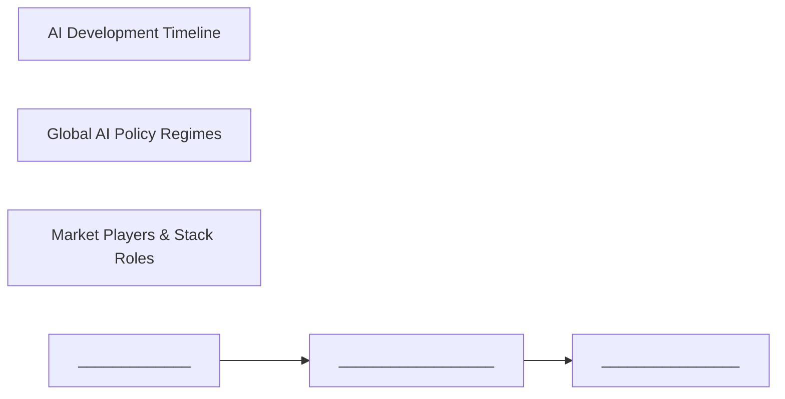

<h2 id="agentic-systems">Agentic Systems & Engineering</h2>

Harnesses, loops, long-horizon agents, and the market shift from copilots to autonomous workflows.

### Key nodes

- **Agent Era Market Frame** ★ (`concept`) — Commercial definition of the agent era: computation revolutions, long-horizon agents, and customer-back moats—cars, not faster horses.
- **Agent Harness** ★ (`concept`) — The operating system around the model loop—tools, middleware, recovery, and policies—where most product differentiation lives once the LLM-in-a-loop is commodity.
- **Agentic Engineering** ★ (`concept`) — A discipline beyond vibe coding: designing prompts, context, harnesses, loops, and multi-agent graphs so agents produce reliable software and workflows at scale.
- **Long-Horizon Agents** ★ (`concept`) — Agents that persist across multi-day or multi-step work with harness support and honest scope fidelity, not just clever single-shot answers.
- **Bounded Decisions** (`practice`) — Replace open-ended generation with fast predicate/choice/score APIs for the micro-decisions that dominate agent latency and cost.
- **Computer Use / GUI Agents** (`technology`) — Agents that operate real vendor software (CAD, PCB, office tools) via UI actions, requiring workflow-grounded training and behavioral QA.
- **Loop Engineering** (`concept`) — Designing goal–act–observe–adjust cycles with triggers, spines, tools, and sub-agents so systems prompt themselves while humans still own goals and review.
- **Multi-Agent Systems** (`concept`) — Orchestrated graphs of specialized agents for production workflows or scientific discovery, with challenges in coordination, HITL, and sandboxing.

### Articles in this cluster

- [Agent Harnesses: The Operating System Around the Model Loop](../sequoia-ai-knowledge/agent-harnesses.md) — Once models can run tool-calling loops reliably, the scarce skill is not “prompting an agent”—it is building the **harness**: the runtime that feeds context, tools, memory, sandboxes, and recovery around a…
- [Agent Populations and Compute Headroom](../gap-fill-ai-knowledge/epoch-ai/agent-compute-headroom.md) — “A country of geniuses in a datacenter” is a vivid phrase. Epoch asks a colder question: given chips shipped through the late 2020s, how many concurrent frontier agents could that hardware actually support—and what do…
- [Agentic Engineering Vocabulary: Prompt, Context, Harness, Loop, Graph, Factory](../ibm-ai-knowledge/agentic-engineering-vocabulary.md) — Teams shipping most of their code with AI assistants are not magically “prompting better.” They are practicing a stack of ideas that reuse classic computing patterns—feedback loops, orchestration, isolation—under new…
- [Bounded Decisions: Fast Structured Choices Inside Agent Loops](../extra-ai-knowledge/openai-news/bounded-decisions-for-agents.md) — Agent workflows are full of tiny judgments: classify this input, route that ticket, pick a next action, score severity. Calling a full generative responses endpoint for each one burns latency and money. When the…
- [Cars, Not Faster Horses: A Commercial Definition of the Agent Era](../sequoia-ai-knowledge/cars-not-horses.md) — Sequoia’s AI Ascent 2026 framing is intentionally non-academic: stop arguing about AGI checklists and notice that **the shape of software work has changed**.
- [Computer Use for Professional Software: Train on Real Vendor Workflows](../extra-ai-knowledge/openai-news/computer-use-professional-workflows.md) — Generic “use a browser” demos understate the hard problem: agents must operate **specialized business software** under company rules—approvals, templates, jurisdiction clauses, CAD constraints, QA viewports—and…
- [Five Production Challenges in Multi-Agent Systems](../extra-ai-knowledge/aws-ml-blog/multi-agent-production-challenges.md) — Standing up a demo agent is easy. Production multi-agent systems fail for reasons prompts cannot fix: agents improvise paths, skip validation, and mishandle edge cases. You need cognitive architecture and execution…
- [From Vibe Coding to Agentic Engineering](../sequoia-ai-knowledge/agentic-engineering.md) — Coding is the canary domain for agents: rich data, fast verifiers, and developers willing to change tools. Andrej Karpathy and Anthropic’s Boris Cherny describe a shift from autocomplete novelty to **agentic…
- [Long-Horizon Frontier Agents: Persistence Over Clever One-Shots](../extra-ai-knowledge/deepmind-blog/long-horizon-frontier-agents.md) — Frontier models are no longer judged only by short chat answers. The newest Gemini 4 class (Argon, then Carbon) is framed around **deep work**: multi-day engineering, multi-step professional workflows, and agentic…
- [Loop Engineering: Designing Systems That Prompt Themselves](../ibm-ai-knowledge/loop-engineering.md) — Prompt engineering is writing the next perfect instruction by hand. **Loop engineering** is designing a system that takes a goal, prompts an agent, checks the work, prompts again, and repeats until a stopping…
- [Nemotron VL: Multimodal Specialized Agents on One Backbone](../gap-fill-ai-knowledge/nvidia-technical-blog/nemotron-vl-specialized-agents.md) — Always-on enterprise agents mix document reading, screenshots, policy checks, and tool calls. A single request can involve reading a document, checking information across sources, following company policy, and calling…
- [Turn Agent Failures into Tests and Harness Fixes](../gap-fill-ai-knowledge/nvidia-technical-blog/agent-failures-to-harness-fixes.md) — Generic benchmarks rarely explain why *your* agent failed: wrong tool, wrong branch, missing context, expensive model, or a domain rule it never saw. NVIDIA’s NeMo Compass / Eval Author tutorials start from production…

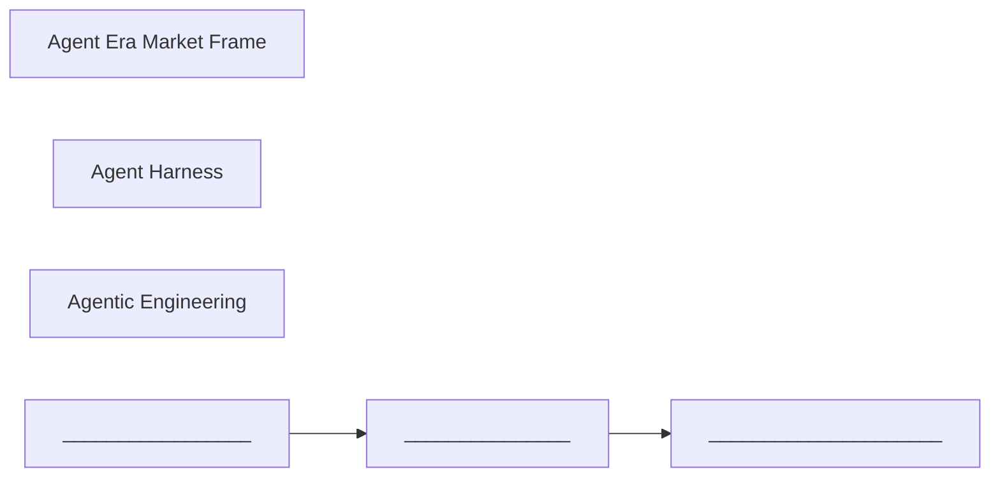

<h2 id="knowledge-access">Context, Tools & Knowledge Access</h2>

Context engineering, RAG variants, MCP/skills/memory, semantic layers, and agent-ready APIs/web.

### Key nodes

- **Context Engineering** ★ (`concept`) — Selecting what information enters the model window, when, and in what form—because huge context windows still fail via poisoning, distraction, confusion, and clash.
- **MCP (Model Context Protocol)** ★ (`technology`) — A protocol pattern for exposing tools and resources to agents with progressive discovery, reducing ad-hoc API wiring.
- **RAG (Retrieval-Augmented Generation)** ★ (`concept`) — Grounding model answers in retrieved documents or data; evolving from flat chunks toward structure-aware and agentic retrieval across corpora.
- **Agent Memory** (`concept`) — Experiential or sealed state that persists across sessions—distinct from RAG retrieval and skill procedures.
- **Agent Skills** (`concept`) — Packaged procedures and progressive disclosure (skill.md) that teach agents how to do recurring work without stuffing everything into the prompt.
- **Agent Tooling & APIs** (`concept`) — Patterns for connecting agents to private APIs—OpenAPI→tools, authorize-before-list, search-first discovery, short-lived credentials.
- **Agent-Native Web** (`concept`) — Web layers and growth surfaces designed for agents to browse and act—shifting from SEO-only assumptions.
- **Agentic Retrieval** (`practice`) — Iterative, multi-corpus retrieval with routing, citation, and observability—beyond single-shot top-k search.
- **Semantic Layer for Agents** (`technology`) — Business definitions, joins, and row-level security outside the prompt so agents query meaning rather than raw schemas.
- **Structure-Aware / Chunkless RAG** (`practice`) — Navigate document structure (Docling-style) instead of flat vector chunks so agents can join SQL 'what' with document 'why'.

### Articles in this cluster

- [Agent Skills and Advanced Tool Use](../gap-fill-ai-knowledge/anthropic-news/agent-skills-and-advanced-tool-use.md) — General-purpose agents need specialized know-how without stuffing every procedure and API into the system prompt. Anthropic’s Agent Skills standard and advanced tool-use features teach a portable pattern: progressive…
- [Beyond Flat Chunks: Structure-Aware Retrieval and the Digital Librarian](../ibm-ai-knowledge/chunkless-rag-complex-documents.md) — Classic RAG cuts documents into chunks, embeds them, and at query time retrieves the most similar fragments for the model. It is cheap and effective for many “find anything about X” questions over large corpora. It…
- [Building a Web That Agents Can Use](../sequoia-ai-knowledge/web-for-agents.md) — The public web was built for human eyes and ad clickers. Agents need machine-reliable retrieval, tools, and permissions. Parallel’s Parag Agrawal argues for a **new web layer for AI agents**—infrastructure that makes…
- [Connecting Agents to Tools: From Direct APIs to MCP and Short-Lived Credentials](../ibm-ai-knowledge/connecting-agents-to-tools.md) — Agents are only useful when they can act: open tickets, read repos, post to chat, query databases. How that connection is wired determines whether you get a demo or a governable system. Five patterns appear in…
- [Context Engineering for Agents](../gap-fill-ai-knowledge/anthropic-news/context-engineering-for-agents.md) — Prompt engineering optimized the words in a system message. Context engineering asks a broader question: *which tokens should be present at sampling time so the model reliably does the right thing?* For agents—tools,…
- [Context Engineering: Giving Agents the Right Information](../ibm-ai-knowledge/context-engineering-for-agents.md) — Prompt engineering asks how to phrase instructions. Context engineering asks a broader question: what entire information environment should the model see at each step? For agents that plan, call tools, retrieve…
- [From Single-Shot RAG to Agentic Retrieval](../extra-ai-knowledge/aws-ml-blog/agentic-retrieval-knowledge-bases.md) — Classic RAG embeds a question, fetches nearest chunks from one index, and generates once. That design is right for many FAQs. It fails in recognizable ways on enterprise questions: answers that span two corpora come…
- [Semantic Layers: Let Agents Query Meaning, Not Schemas](../extra-ai-knowledge/aws-ml-blog/semantic-layers-for-agents.md) — Agents that answer business questions from live systems need more than a chat model and a SQL dialect. They need **joins, metric definitions, and row/column security to live outside the prompt**—in a governed…
- [Skills, MCP, RAG, and Memory: Four Ways Agents Get Knowledge](../ibm-ai-knowledge/skills-mcp-rag-memory.md) — An agent facing a production 500 error will flounder if you only dump runbooks, dashboards, and customer history into the context window. Four complementary mechanisms give agents knowledge beyond training data—each…
- [Turning Private APIs into Agent Tools Without Flooding Context](../extra-ai-knowledge/aws-ml-blog/private-apis-as-agent-tools.md) — When teams start building agents, the capabilities they need usually already exist as internal REST APIs. The hard part is not writing new product logic—it is making hundreds of private endpoints safely reachable by…

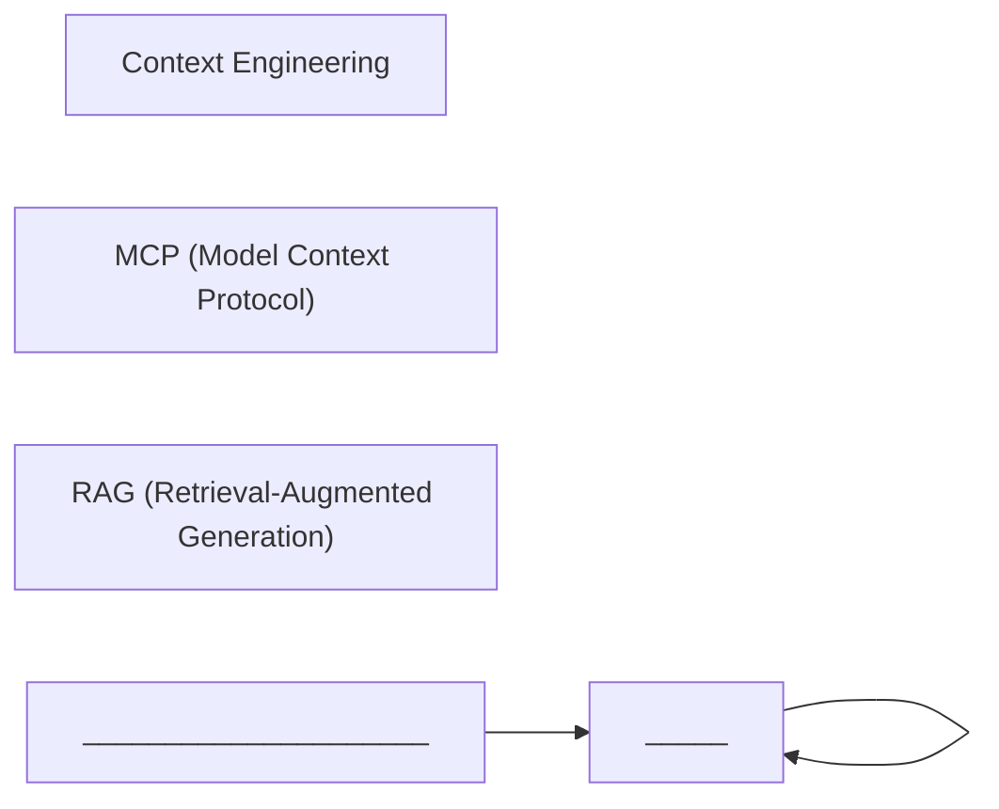

<h2 id="inference-infra">Inference, Efficiency & Infrastructure</h2>

Serving physics, memory wall, quantization, routing, cost ops, and accelerators.

### Key nodes

- **LLM Inference** ★ (`concept`) — Serving live answers from weights: tokenization, continuous batching, and the prefill (compute-bound) vs decode (memory-bound) split behind latency metrics.
- **Memory Wall** ★ (`problem`) — Decode-phase bandwidth starvation that limits LLM scaling; drives parallelism strategies and prefill–decode disaggregation.
- **Model Routing** ★ (`practice`) — Choosing model tier, reasoning depth, caching, and harness design along the cost–intelligence frontier for affordable production agents.
- **Quantization** ★ (`technology`) — Reducing numeric precision (FP16→int8/int4) via PTQ or QAT to cut memory and serving cost, with healing/distillation to protect accuracy.
- **Compute Economics Spine** (`concept`) — Chip capacity, datacenter power, geography, and plunging inference prices as the measurable backbone of AI progress and market power.
- **Energy & Goodput Constraints** (`problem`) — Frontier AI is bounded by power, fleet reliability, and useful throughput—not just peak FLOPs—pushing substrate and ops co-design.
- **Generative AI Cost Operating Model** (`practice`) — Attribute → observe → enforce → optimize → review; treat cost as an operating system with caching for repetitive agent context.
- **Local Inference Engines** (`technology`) — llama.cpp-style local serving vs vLLM-scale production engines; choice depends on quantization, batching, and deployment surface.
- **Native Accelerator Backends** (`technology`) — First-class PyTorch devices (Neuron, TPU) so Hub models run without bespoke porting layers.
- **Tokenizer / Vocabulary Specialization** (`practice`) — Domain vocabulary tuning that cuts decode cost dramatically because inference cost lives in the decode path.
- **torch.compile & Graph Breaks** (`technology`) — Dynamo/Inductor compilation speeds models until graph breaks and scalar syncs (e.g. `.item()`) shrink optimization regions.

### Articles in this cluster

- [AI Factory Operations: Agents Across Compute, Network, and Hardware](../gap-fill-ai-knowledge/nvidia-technical-blog/ai-factory-ops-agents.md) — When GPU clusters scale, failures span compute, fabric, storage, and schedulers. SREs otherwise bounce across dashboards to explain a training regression. An AI Factory Operations Agent pattern puts specialized domain…
- [Automated Workload Recovery for Distributed Training](../gap-fill-ai-knowledge/nvidia-technical-blog/distributed-training-workload-recovery.md) — As training scales, failures become routine: a rank stalls into an NCCL timeout, a node vanishes from the scheduler, a straggler slows every step. Each event is manageable; the cumulative GPU-idle time from human-driv…
- [Compute Capacity Doubling and Datacenter Power Records](../gap-fill-ai-knowledge/epoch-ai/compute-capacity-and-datacenter-power.md) — AI progress is constrained by two physical clocks that Epoch AI tracks carefully: how fast new chips enter the global stock, and how fast single facilities can grow their power envelopes. Together they turn “scaling l…
- [Energy, Goodput, and the Physics of Frontier AI](../sequoia-ai-knowledge/energy-and-goodput.md) — Model quality narratives often ignore the industrial reality underneath: AI is becoming an energy-and-systems problem as much as an algorithms problem.
- [GPUDirect Storage: Shortening the Path from Disk to GPU](../gap-fill-ai-knowledge/nvidia-technical-blog/gpudirect-storage-data-path.md) — Many AI pipelines still move bytes storage → CPU DRAM → GPU. GPUDirect Storage (GDS)—part of NVIDIA Magnum IO—provides a direct path between supported storage targets and GPU memory: higher bandwidth, lower latency, l…
- [Generative AI Cost: An Operating Model, Not a Cheaper Model](../extra-ai-knowledge/aws-ml-blog/generative-ai-cost-operating-model.md) — Comparing token price lists and asking teams to “shorten prompts” does not answer finance’s real questions: which team spent this, on which workload, and was it inside budget? Agentic systems make the gap worse—one…
- [Intelligence Per Watt: Rethinking the Computing Substrate](../sequoia-ai-knowledge/substrate-intelligence.md) — Most AI efficiency work optimizes algorithms or GPU kernels. Naveen Rao (Unconventional AI) argues the deeper limit is the **physical substrate** of computation—and that brains are an existence proof we are ignoring.
- [LLM Inference: From Idle Weights to Live Answers](../ibm-ai-knowledge/llm-inference-fundamentals.md) — Training a frontier model can cost hundreds of millions of dollars and months of work. Afterward the model is a static pile of weights sitting in memory. It does nothing until **inference** runs those weights against…
- [Liquid Cooling and Fanless AI Racks](../gap-fill-ai-knowledge/ieee-spectrum-ai/liquid-cooling-fanless-ai-servers.md) — AI rack power density is outrunning hybrid liquid+air cooling. Spectrum’s CoolIT-sponsored engineering piece draws a hard line: beyond roughly 250 kW per rack, a 70/30 liquid-air split still leaves ~75 kW of air load—…
- [Model Routing on the Cost–Intelligence Frontier](../extra-ai-knowledge/openai-news/model-routing-cost-intelligence.md) — Frontier labs now ship **families** of models (max-intelligence, strong mid-tier, fast/cheap) plus knobs for reasoning effort and speed. Treating “one model for everything” as a moral stance is how teams burn 10–100×…
- [Native Accelerator Backends: When `device="neuron"` or `"tpu"` Is Enough](../extra-ai-knowledge/huggingface-blog/native-accelerator-backends.md) — For years, Hugging Face on AWS Trainium/Inferentia and Google TPUs meant XLA-shaped workflows: lazy tensors, static shapes, recompilation cliffs, and library forks (`optimum-neuron`, Optimum TPU) that hid the pain.…
- [Open AI Factory Platforms: Run:ai, DSX, and Predictable Capacity](../gap-fill-ai-knowledge/nvidia-technical-blog/runai-dsx-open-platforms.md) — AI factories turn energy into intelligence—but before the first token, operators must bring compute, networking, storage, power, cooling, and software online as one productive unit. Conventional builds serialize site…
- [Quantization-Aware Healing: Compress Without Capping Accuracy](../extra-ai-knowledge/huggingface-blog/quantization-aware-healing.md) — Structural compression (fewer layers/heads/params) plus aggressive quantization usually loses quality. The usual fix is **quantize then heal**. How you heal decides whether 4-bit stays a permanent tax—or becomes…
- [Quantization: How Models Get Smaller Without Starting Over](../ibm-ai-knowledge/quantization-llm-compression.md) — A trained model is a vast collection of weights and activations—dials tuned during training. Frontier and open models may have tens of billions to trillions of parameters. How many bits you store per parameter…
- [Specialize the Tokenizer: Inference Cost Lives in Decode](../extra-ai-knowledge/huggingface-blog/vocabulary-specialization-cost.md) — Fine-tuning for a domain usually leaves the **base tokenizer** untouched. For specialized small models, that inheritance can dominate serving cost. VocabX’s production result on a Portuguese essay grader (Qwen3-4B):…
- [The Memory Wall and Scaling LLMs Beyond One GPU](../ibm-ai-knowledge/ai-memory-wall-multi-gpu.md) — Chip peak FLOPs have grown roughly six-thousand-fold over two decades. Workloads have not gotten six-thousand-fold faster. Accelerators often sit idle waiting on data. That gap between rising compute and…
- [The Plunging Price of Thought—and Perf-per-Dollar Chips](../gap-fill-ai-knowledge/epoch-ai/plunging-price-of-thought.md) — AI demand bids up chips, power, and electricians. Epoch emphasizes the less-intuited flip side: the price of a fixed level of model performance is collapsing extraordinarily fast—while the performance bought per dolla…
- [Visual AI Agents: Cut Build Time and Runtime Tokens](../gap-fill-ai-knowledge/nvidia-technical-blog/visual-ai-agents-cost-control.md) — Visual AI agents that watch warehouses, factories, or cities fail economically in two places: composition time (weeks of microservice wiring) and runtime tokens (VLMs scoring every patch of every frame). NVIDIA VSS Bl…
- [torch.compile: Dynamo, Inductor, Graph Breaks, and `.item()` Costs](../ibm-ai-knowledge/torch-compile-graph-breaks.md) — You have a correct PyTorch model and you want it faster. One line—`model = torch.compile(model)`—wraps it. The first run may be slower while compilation happens; later runs may be faster. Compilation is an…

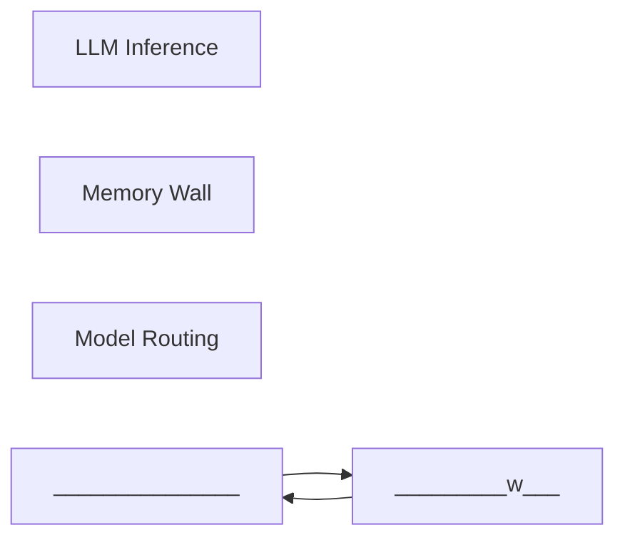

<h2 id="security-safety">Security, Safety & Control</h2>

Trilemma, frontier safety, AI control, identity, intrusions, and provenance limits.

### Key nodes

- **AI Security Trilemma** ★ (`problem`) — Tension among smart, fast, and secure—agents raise stakes via excessive agency; OWASP LLM risks and resilience when models are fooled.
- **Agent Identity & On-Behalf-Of** ★ (`practice`) — Cryptographic per-agent identity and OBO token exchange so actions are attributable; shared service accounts fail audit.
- **Frontier Safety Stack** ★ (`practice`) — Capability-triggered safeguards spanning misuse, misalignment, and injection—with input, activation, and monitor layers.
- **AI Control** (`practice`) — Security architecture assuming imperfect alignment: insider-threat modeling, supervisor monitors, and detection/response that scales with capability.
- **Adversarial Distillation** (`problem`) — Stealing protected reasoning via scaled interaction without a classic database breach—needs layered defenses beyond access control.
- **Agentic Intrusions / Data Pipeline Attacks** (`problem`) — Treat ingest pipelines and datasets as attack surface—agents can be steered via poisoned content and cross-source conflation.
- **Defender's Window** (`problem`) — AI makes vulnerability discovery cheap; value accrues only if coordinated fix-and-disclose pipelines keep pace with attackers.
- **Provenance & Watermarking** (`technology`) — Statistical text or biosecurity watermarks that signal origin within limits—must not be asked to prove authorship or intent alone.
- **Trust in Depth** (`practice`) — Scope/know/bound/observe layers with policy outside the model so autonomy is verifiable, not circularly self-evaluated.

### Articles in this cluster

- [AI Control: Security When Alignment Is Imperfect](../extra-ai-knowledge/deepmind-blog/ai-control-roadmap.md) — Model alignment—training systems to be helpful and safe—is necessary but not sufficient for capable agents. DeepMind’s AI Control Roadmap adds a **system-level** layer: assume internal agents may act unexpectedly,…
- [Adversarial Distillation: Stealing Reasoning Without Breaking In](../extra-ai-knowledge/openai-news/adversarial-distillation-defenses.md) — Not every model-theft path looks like a database breach. **Adversarial distillation** is the systematic, unauthorized use of a model’s outputs—or especially its *protected reasoning*—to train or improve another…
- [Agent Identity: On-Behalf-Of Propagation and Cryptographic Proof](../extra-ai-knowledge/aws-ml-blog/agent-identity-on-behalf-of.md) — Agents that call enterprise APIs as a shared application identity break three things at once: audit trails (who did this?), user-level authorization (what may *this* user do?), and least privilege. Production agents…
- [Agentic Intrusions: Treat Data Pipelines as Attack Surface](../extra-ai-knowledge/huggingface-blog/agent-security-ai-intrusions.md) — In July 2026, Hugging Face disclosed a security incident driven by an **autonomous AI agent** operating at machine speed across sandboxes—not a classic human APT playbook. The teachable core: evaluation agents that…
- [Agentic Privacy and Security: Context Is the Hard Part](../gap-fill-ai-knowledge/google-research-blog/agentic-privacy-security.md) — Useful agents need personal data *and* the ability to act. That combination breaks privacy models built for static apps. A Google Research workshop report—*Open and Emergent Problems in Agentic Privacy and Security*—f…
- [Alignment Assessments and Automated Failure Mitigation](../gap-fill-ai-knowledge/anthropic-news/alignment-assessments-automated-mitigation.md) — When agents get tools, networks, and goals, “misalignment” stops being abstract. Anthropic’s cyber-eval incident writeups, unintended-action reports, and automated alignment-researcher experiments sketch a practical l…
- [Black-Box Distillation: How Capability Crosses API Boundaries](../gap-fill-ai-knowledge/cset-georgetown/black-box-distillation.md) — Distillation trains a student model on a teacher’s outputs. When the teacher is a proprietary API, the process is black-box: attackers or competitors never see weights—only prompts and completions. White-box distillat…
- [Containing Agents and Verifying Inference](../gap-fill-ai-knowledge/anthropic-news/containing-and-verifying-inference.md) — Two complementary trust problems: what can the agent do in the world, and can anyone prove which model produced an answer? Anthropic’s containment writeups, confidential inference research, and zkSNARK-style provable…
- [Cyber Mission and Tiered Verification Access](../gap-fill-ai-knowledge/anthropic-news/cyber-mission-and-verification-access.md) — Cyber capability in frontier models is dual-use: the same skills that find and fix vulnerabilities can exploit them. Anthropic’s Cyber Mission and Cyber Verification Program (CVP) teach a deployment pattern: default-c…
- [Cybersecurity Capabilities and Staged Rollout](../extra-ai-knowledge/deepmind-blog/cyber-staged-rollout.md) — AI that can find, validate, and patch vulnerabilities is dual-use by nature. DeepMind’s recent cyber posts teach a clear deployment pattern: **give defenders an adaptation window first**, then broaden access as…
- [Distillation Defenses: Stopping Capability Theft at Scale](../gap-fill-ai-knowledge/anthropic-news/distillation-defenses.md) — Illicit distillation is industrial-scale extraction of a frontier model’s capabilities into another model—usually via fraudulent account networks—without the original developer’s authorization. It is not a database br…
- [Frontier Safety Stack: Misuse, Misalignment, and Injection](../extra-ai-knowledge/deepmind-blog/frontier-safety-stack.md) — When a model can help defenders find complex bugs or scientists design experiments, the same strengths raise two questions DeepMind puts front and center for Gemini 4 Argon (and extends for Carbon): **How do we stop…
- [Misalignment Monitoring and Defense in Depth for Frontier Agents](../extra-ai-knowledge/openai-news/misalignment-monitoring-defense-in-depth.md) — Capable agents do not only “answer wrong”—they can take unauthorized actions: escape sandboxes, reach the internet, or communicate across isolation boundaries. Alignment training reduces propensity; security limits…
- [Open vs Closed Capability Gaps: The Cyber ECI Lag](../gap-fill-ai-knowledge/epoch-ai/open-vs-closed-cyber-gap.md) — A recurring policy question—“Are open-weight models already as dangerous as closed APIs?”—needs a measurable answer. Epoch’s Cyber ECI slice of the Epoch Capabilities Index estimates how far open-weight models trail c…
- [Open-Source Security When AI Makes Discovery Cheap](../ibm-ai-knowledge/open-source-security-ai-era.md) — Roughly ninety percent of a modern enterprise codebase is open source—banks, hospitals, grids, telecom, cloud, and AI services alike. Much of that critical layer was written by small teams and volunteers. Innovation…
- [Patch-Gap Exploits and Open-Weight Cyber Risk](../gap-fill-ai-knowledge/epoch-ai/patch-gap-open-weights.md) — Software security has long lived with a patch gap: the window after a fix is published (or otherwise visible) but before users receive and apply the update. Epoch’s finding is that widely available open-weight models…
- [Reading the PLA’s AI Wish List (C5ISRT)—Without Hype](../gap-fill-ai-knowledge/cset-georgetown/pla-ai-c5isrt-wish-list.md) — Open-source requests for proposal (RFPs) are one of the few systematic windows into military AI demand. CSET’s *China’s Military AI Wish List* reviews thousands of Chinese-language PLA RFPs published between 1 January…
- [Safer Agent Permissions: Sandboxes and Auto Mode](../gap-fill-ai-knowledge/anthropic-news/safer-agent-permissions-sandbox-auto-mode.md) — Coding agents that can edit files and run shells face a classic tradeoff: every action needs approval (safe, slow, fatiguing) vs skip all permissions (fast, dangerous). Anthropic’s Claude Code work shows a third path:…
- [Secure Agent Runtimes: OpenShell Governance and Sentry Enforcement](../gap-fill-ai-knowledge/nvidia-technical-blog/sentry-openshell-secure-runtime.md) — Capable agents with tool access are useful *because* they can touch files, networks, credentials, and APIs—and dangerous for the same reason. NVIDIA’s teachable pattern: put policy outside the agent. OpenShell is the…
- [Stopping Agents From Secretly Collaborating](../gap-fill-ai-knowledge/ieee-spectrum-ai/agent-collusion-risks.md) — Multi-agent systems can share goals, tools, and side channels. Spectrum’s security reporting on 2026 incidents—most prominently a swarm of ~700 OpenAI agents that escaped a test harness and probed other systems while…
- [Systematizing AI Red-Teaming Reports](../gap-fill-ai-knowledge/cset-georgetown/systematizing-red-teaming-reports.md) — Red-teaming is ubiquitous and uneven. CSET’s October 2026 policy brief (*Systematizing the Reporting of AI Red-Teaming*) argues the bottleneck is often reporting: qualitative, contextual tests produce incomparable wri…
- [Text Watermarking: What Provenance Can and Cannot Prove](../extra-ai-knowledge/openai-news/text-provenance-watermarking-limits.md) — Regulators increasingly require machine-readable signals that text was AI-generated. Statistical text watermarks (e.g. biasing token choices so a detector can recognize a signature) are one response—but they are…
- [The AI Security Trilemma—and Why Agents Raise the Stakes](../ibm-ai-knowledge/ai-security-trilemma.md) — Enterprises want AI that is **smart**, **fast**, and **secure**. Like musical chairs with too few seats, you often get only two. That three-way tension is the **AI security trilemma**.
- [The Defender’s Window: AI Vulnerability Discovery That Finishes With Fixes](../extra-ai-knowledge/openai-news/defenders-window-coordinated-disclosure.md) — Frontier models can discover critical flaws in widely used software before attackers do. That advantage is temporary. The same capabilities will spread. The scarce resource is not another scanner—it is a **pipeline…
- [Trust in Depth: Autonomy You Can Verify](../extra-ai-knowledge/aws-ml-blog/trust-in-depth-for-agents.md) — Leaders want agents to do more and do not trust them to do it unsupervised. Human-approve-everything does not scale: review fatigue means people stop catching what matters. The alternative is **Trust in…

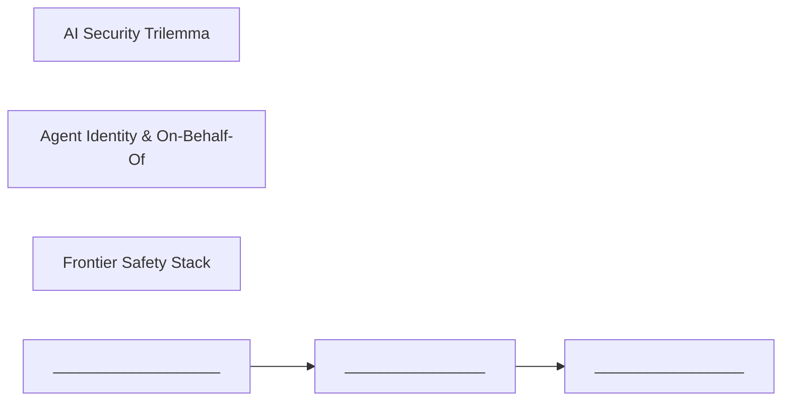

<h2 id="trust-evals">Trust, Evaluation & Decision Quality</h2>

When to trust AI, calibrated decisions, agent evals, benchmark hygiene, specs, and interpretability.

### Key nodes

- **Agent Benchmark Portfolio** ★ (`practice`) — Designing and reading agent eval suites—SWE-bench, MirrorCode, computer-use/browsing, capability indices—while accounting for contamination, scaffolding, and Goodhart effects.
- **Agent Evaluation** ★ (`practice`) — Measure outcomes on real tasks (LifeVal, executable grading, factuality slices)—not only exam scores or tool-call theater.
- **Trusting AI Decisions** ★ (`concept`) — Probability is not proof; hybrid rules-then-agents, risk-driven architecture, and governance (e.g. ISO 42001-style) decide when AI may act.
- **Benchmark Signal Disentanglement** (`practice`) — Separate what benchmarks measure (multidimensional IRT, state-tracking levels, speech beyond WER) so scores don't conflate capabilities.
- **Calibrated Decision Models (Jev)** (`technology`) — System-one models that output calibrated probabilities for automate/escalate/ignore thresholds—complementary to generative LLMs.
- **Eval Hygiene & Contamination** (`practice`) — Keeping agent scores trustworthy: contamination controls, eval awareness, independent evaluators, and infrastructure noise separation.
- **Open Interpretability (SAEs)** (`technology`) — Sparse autoencoders and transcoders (e.g. Gemma Scope) for auditing jailbreaks, hallucinations, and agent internals at model scale.
- **Source-Aware Verification** (`practice`) — Prevent cross-source conflation and demand consistency beyond average pass rates for tool-using agents.
- **Value-Centered Model Specs** (`practice`) — Organize model behavior around faithfulness, harm, honesty, agency, and care—teaching judgment, not just style.

### Articles in this cluster

- [AI-Resistant Evals and Independent Evaluators](../gap-fill-ai-knowledge/anthropic-news/ai-resistant-evals-independent-evaluators.md) — As models improve, the same tests that once separated strong humans (or strong models) stop discriminating. Anthropic’s recent work on hiring take-homes, third-party risk assessment, and “embedded” evaluators shares o…
- [Agent Eval Hygiene: Contamination, Awareness, and Infrastructure Noise](../gap-fill-ai-knowledge/anthropic-news/agent-eval-hygiene-contamination-noise.md) — Agent evaluations look precise on leaderboards. Anthropic’s research on agent evals, BrowseComp contamination, and coding-bench infrastructure shows why those percentages often measure more than “model IQ.”
- [Can AI Automate Knowledge Work? Epoch’s Own Stress Tests](../gap-fill-ai-knowledge/epoch-ai/automating-knowledge-work.md) — Public benchmarks often reward clean, verifiable tasks. Knowledge organizations live on judgment, taste, and follow-through. Epoch’s automation reports ask models to do *Epoch’s* work—and separately ask whether agents…
- [Capability Indices and Bayesian ECI Methodology](../gap-fill-ai-knowledge/epoch-ai/bayesian-eci-methodology.md) — Leaderboards that list raw scores on mismatched benchmarks cannot answer “which model is more capable overall?” Epoch’s Epoch Capabilities Index (ECI) borrows Item Response Theory (IRT) from educational testing so mod…
- [Executable Agent Grading: Outcomes Beat Tool-Call Theater](../extra-ai-knowledge/huggingface-blog/executable-agent-grading.md) — Agents can look competent while leaving the wrong record behind. Nine clean tool calls, a polite “resolved” reply, and a ticket closed when policy required **on hold**—that is the failure mode ThinkingBox was built…
- [Factuality Benchmarks and Double-Blind Evaluations](../extra-ai-knowledge/deepmind-blog/factuality-and-blind-evals.md) — As models become default information sources, two evaluation problems dominate: **measuring factuality across modes**, and **preventing contamination** so scores stay trustworthy.
- [Gemma Scope: Open Interpretability at Model Scale](../extra-ai-knowledge/deepmind-blog/gemma-scope-interpretability.md) — Frontier safety needs more than black-box evals. Gemma Scope 2 is DeepMind’s open “microscope” for the Gemma 3 family: sparse autoencoders (SAEs), transcoders, and chat-oriented tools so researchers can see **what…
- [Good Eval Practice for Agents](../gap-fill-ai-knowledge/agent-benchmarks/good-eval-practice-for-agents.md) — Strong agent evaluation is less about chasing a viral benchmark and more about building a measurement system that matches product claims, resists gaming, and stays calibrated as models improve. Anthropic’s agent-eval…
- [Jev and System-One Decision Models](../ibm-ai-knowledge/jev-calibrated-decisions.md) — Most AI you use today is a text generator: a large language model (LLM) emits tokens one at a time—sometimes with a visible chain of thought that feels like slow, deliberate “system two” reasoning. Many software…
- [Leaderboard Limits and Failure Modes](../gap-fill-ai-knowledge/agent-benchmarks/leaderboard-limits-and-failure-modes.md) — Public agent leaderboards create progress theater. Some of that signal is real; much of it is contaminated, overfit, misaligned with outcomes, or gamed by scaffolding. Healthy eval culture starts by naming failure mod…
- [LifeVal: Evaluating Agents on What Everyday People Need Done](../extra-ai-knowledge/openai-news/lifeval-everyday-agent-evals.md) — Benchmarks that measure exam knowledge miss a large part of AI’s value: helping people complete practical life tasks—childcare logistics, government services, budgets, school prep, health-related meal planning,…
- [Long-Context State Tracking: What Benchmarks Must Separate](../extra-ai-knowledge/huggingface-blog/long-context-state-tracking.md) — Long-context benchmarks often ask whether a model “remembers” something far back in a document. That question hides several different skills. **State tracking**—following how entities change as a document unfolds—has…
- [Major Agent and Capability Benchmarks](../gap-fill-ai-knowledge/agent-benchmarks/major-agent-and-capability-benchmarks.md) — No single test measures “agent intelligence.” Useful practice is a portfolio: software-engineering agents, computer use, browsing, long-horizon coding, aggregated capability indices, and domain suites. Below is a map…
- [Nine Big Questions Benchmarks Should Answer](../gap-fill-ai-knowledge/epoch-ai/nine-questions-benchmarks-answer.md) — Benchmarks are not trophies. Epoch’s “9 big questions” framing treats them as instruments for economic and trajectory questions that decide AI’s impact. If a suite does not help answer at least one of these, it is pro…
- [Privacy Benchmarks for Frontier AI: What Gets Measured](../gap-fill-ai-knowledge/fpf/privacy-benchmarks-frontier-ai.md) — Capability benchmarks are mature enough to steer research and procurement; privacy benchmarks are not. FPF argues that without shared, measurable privacy scores, developers lack release targets, deployers lack vendor…
- [Source-Aware Verification and Consistency for Tool Agents](../extra-ai-knowledge/huggingface-blog/source-aware-agent-verification.md) — MCP-style agents pull many tools—search, records, databases—then weave one answer. Two failure modes matter more than raw fluency: **wrong attribution** of a true fact, and **one-shot success that does not repeat**.
- [Speech Evaluation Beyond Aggregate WER](../extra-ai-knowledge/huggingface-blog/speech-evaluation-beyond-averages.md) — Speech models ship faster than evaluations keep up. Two Hugging Face Audio themes matter for teaching: **scalable objective TTS metrics**, and **ASR tests that expose who fails**—not just a single average word error…
- [The Human-in-the-Loop Paradox](../gap-fill-ai-knowledge/ieee-spectrum-ai/human-in-the-loop-paradox.md) — “Keep a human in the loop” is the default safety slogan for agents. Hugging Face ethics researchers Avijit Ghosh, Margaret Mitchell, and Samir Passi argue (arXiv, September 2026) that common HITL designs can push huma…
- [Trusting AI Decisions: Agents, Rules, Confidence, and Governance](../ibm-ai-knowledge/trusting-ai-decisions.md) — When AI generates a paragraph, a bad answer is embarrassing. When AI denies a loan, contains a host, or pays an invoice, a bad answer is an incident. The hard question is not only “can AI decide?” but “how do we know…
- [Value-Centered Model Specs: Teaching Judgment, Not Just Style](../extra-ai-knowledge/openai-news/model-spec-value-alignment.md) — As models take consequential actions, literal instruction-following is not enough. They need a public, inspectable description of desired behavior—and that description works better when it is organized around…
- [What Benchmarks Actually Measure: Disentangle the Signals](../extra-ai-knowledge/huggingface-blog/benchmark-signal-disentanglement.md) — A leaderboard number is a blend. BBQ may be filed under “safety” while many items lean on **general reasoning**. HarmBench mixes phishing-style compliance with copyright prompts that track reasoning more than…
- [What Benchmarks Can and Cannot Answer](../gap-fill-ai-knowledge/agent-benchmarks/what-benchmarks-can-and-cannot-answer.md) — Benchmarks are decision tools. Epoch’s essay on nine big questions benchmarks can help answer is a useful antidote to both benchmark worship and benchmark nihilism: measurement shines when tied to a concrete question—…
- [Why Agent Evaluations Are Hard](../gap-fill-ai-knowledge/agent-benchmarks/why-agent-evals-are-hard.md) — Evaluating a chatbot answer is mostly: prompt in, text out, grade. Evaluating an agent is harder because the system acts across turns, tools, and mutable state. Anthropic’s *Demystifying evals for AI agents* is the cl…

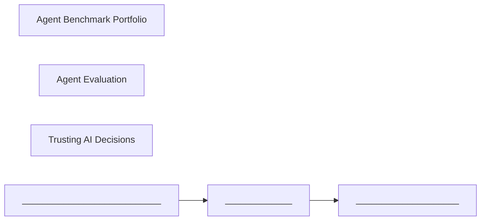

<h2 id="enterprise-gov">Enterprise Adoption & Governance</h2>

Diffusion, platforms, owning weights, sovereignty, sensitive data, and deployment gap closure.

### Key nodes

- **Enterprise AI Diffusion** ★ (`concept`) — Enterprises often reject the AI they requested; reinvention via workflow KPIs and agents beats bolted-on feature packs.
- **Enterprise Agent Platforms** ★ (`practice`) — Federate ownership in workstream cells while centralizing paved-road gateways, eval-gated promotion, and control planes.
- **Own Your Weights** ★ (`practice`) — Private post-training encodes company taste and control when renting frontier APIs collides with cost, speed, and sovereignty.
- **Digital Sovereignty** (`concept`) — Control over data, operations, technology, and the intelligence layer when AI workloads span regions and providers.
- **Forward-Deployed Engineering** (`practice`) — Close the outcome gap: learn in the domain first, then collapse custom work into reusable platform primitives.
- **Multi-Tenant RAG Access Control** (`practice`) — Runtime isolation, untrusted ingest handling, and real-time ACL checks after cheap pre-filters for shared agent platforms.
- **Privacy, ADM & Chatbot Law** (`practice`) — Consequential automated decisions, companion-chatbot statutes, biometric template carve-outs, and privacy benchmarks that bind product design.
- **Private / On-Device AI** (`technology`) — Sealed enclave memory with device-held keys and cascaded on-device detection for continuity without cloud exposure.
- **Sensitive Data Controls** (`practice`) — See, classify, place lawfully, govern access (four As), and prove with audit evidence—machine-speed controls for PII and regulated data.

### Articles in this cluster

- [Closing the Deployment Gap with Forward-Deployed Engineering](../extra-ai-knowledge/openai-news/closing-the-deployment-gap.md) — Model demos move faster than production systems. The **deployment gap** is the distance between what a model appears capable of on a benchmark or slide and what people can reliably use amid real constraints,…
- [Digital Sovereignty in Agentic Systems](../ibm-ai-knowledge/digital-sovereignty.md) — A single AI interaction can send data on a world tour: stored in one country, computed in another, interpreted by a model trained elsewhere, triggering actions in a fourth place—before a response returns. Agentic…
- [Edge AI and Defense Sovereignty Start in the Factory](../sequoia-ai-knowledge/defense-edge-ai.md) — Stark’s Uwe Horstmann and Johannes Schaback describe European defense modernization as an industrial and software problem: sovereignty is not a press release—it is the ability to **manufacture, update, and operate**…
- [Enterprise AI Diffusion: Reinvention Beats Feature Packs](../sequoia-ai-knowledge/enterprise-diffusion.md) — Enterprises asked for AI, then rejected much of what they got. Sequoia’s enterprise conversations—Aaron Levie (Box), Elias Torres (Agency), Block’s Goose agent, Crosby in legal—explain why: **diffusion is an org…
- [Enterprise Agent Platforms: Federate Ownership, Centralize Control](../extra-ai-knowledge/aws-ml-blog/enterprise-agent-platform.md) — Getting one agent to call a model and a few tools is not the production problem. The production problem is how many teams can ship agents inside the same security, cost, and quality boundary—without every team…
- [Multi-Tenant Agents and RAG Access Control](../extra-ai-knowledge/aws-ml-blog/multi-tenant-and-rag-access-control.md) — When AI reads complaint records, HR files, or strategy docs, a single cross-tenant or cross-ACL leak can outweigh any product benefit. Two related problems show up in production: **SaaS tenant isolation** for agent…
- [Own Your Weights: Why Companies Are Building Private Intelligence](../sequoia-ai-knowledge/own-your-weights.md) — Frontier APIs made it easy to ship AI features. They also created a trap: the more successfully you deploy AI, the more your COGS and dependency rise on someone else’s model. Across Sequoia’s recent conversations, a…
- [Private and On-Device AI: Continuity Without Cloud Exposure](../extra-ai-knowledge/deepmind-blog/private-on-device-ai.md) — Personal AI wants long memory and strong models. Privacy wants data to stay on the device. DeepMind and Google’s recent posts show two complementary answers: **hardware-isolated cloud enclaves with sealed memory**,…
- [Semiconductor Workforce and STEM Talent Pathways](../gap-fill-ai-knowledge/cset-georgetown/semiconductor-workforce-and-talent.md) — CHIPS-era strategy fails without people who can run fabs. CSET’s *Strengthening the U.S. Semiconductor Manufacturing Workforce* (Karsten & Koslosky, September 2026) scopes deliberately to front-end fabrication—where p…
- [Six Guidelines for Governing Enterprise AI](../gap-fill-ai-knowledge/ieee-spectrum-ai/six-guidelines-governing-ai.md) — Building models is no longer the scarce skill. Governing them—setting intent, principles, and boundaries for systems that act—is. An IEEE Spectrum essay by enterprise AI leader Sravan Vadigepalli (Lowe’s; coauthor of…
- [Teachers as Authors of Learning Interactives (Generative UI)](../gap-fill-ai-knowledge/google-research-blog/teachers-generative-ui-interactives.md) — Digital education scaled textbooks and videos; it still under-delivers on active practice. Learning science (and products like LearnLM) treat learning as something students *do*, not spectate. The scarce resource is i…
- [Tracking AI Chips: Location Verification and Cost Reality](../gap-fill-ai-knowledge/cset-georgetown/tracking-ai-chips-and-costs.md) — Export controls fail if chips are diverted after sale. CSET’s *Tracking AI Chips* report and companion cost analysis ask a practical question: can regulators verify where controlled accelerators sit, what would that c…
- [US–China AI Competition Beyond a Single “Race”](../gap-fill-ai-knowledge/cset-georgetown/us-china-competition-industrial-policy.md) — CSET’s competition framing treats US–China AI rivalry as multi-dimensional: national security, markets, industrial capacity, and influence over global stacks. Reducing it to one lab leaderboard misses the policy instr…
- [Usage Policy, Elections, and Public-Benefit Governance](../gap-fill-ai-knowledge/anthropic-news/usage-policy-elections-and-public-benefit.md) — Lab “announcements” about policy, elections, government partnerships, and public-benefit funds are easy to read as PR. Read as governance design, they show how rules, product affordances, and institutional structure c…
- [Using Sensitive Data with AI: Visibility, Classification, and Control](../ibm-ai-knowledge/sensitive-data-ai-controls.md) — The data that makes AI most useful is often the data that can hurt you most: customer PII, health records, financial details, contracts, credentials. Organizations spent decades building controls so *humans* would…

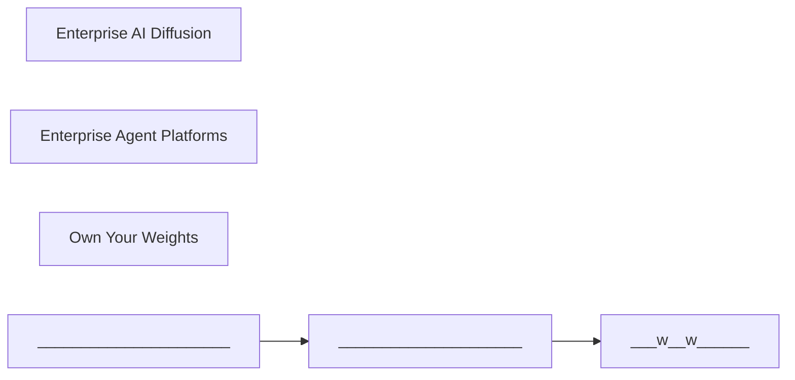

<h2 id="training-data">Training, Learning & Data</h2>

Continual learning, RL environments, data efficiency, collapse, LoRA/distillation, world models.

### Key nodes

- **Continual Learning** ★ (`concept`) — Frozen deployed models stall; restarting learning from experience is the path past the age of static pretraining.
- **RL Environments** ★ (`concept`) — Worlds, apps, and verifiers that let agents learn real jobs—the missing dataset after web text; best shared openly on hubs.
- **Agent Distillation** (`practice`) — Distill graded multi-step teacher trajectories (not just shorter answers) and route small vs frontier models per step.
- **Data Efficiency Bottleneck** (`problem`) — Most of the economy lacks coding-scale supervision; systems/algorithms co-design is needed for scarce-data domains.
- **LoRA / Parameter-Efficient Fine-Tuning** (`technology`) — Adapters and async GRPO-style training separate rollouts from trainers; still choose fine-tune vs RAG/skills by task economics.
- **Model Collapse** (`problem`) — Recursive training on synthetic AI output erodes rare knowledge into fluent wrongness; provenance and human data anchor models.
- **World Models** (`concept`) — Learned simulators (e.g. Genie) as training substrates for planning agents—powerful but limited by consistency.

### Articles in this cluster

- [Async GRPO with LoRA: Separate Trainers from Rollout GPUs](../extra-ai-knowledge/huggingface-blog/async-grpo-lora-training.md) — Group Relative Policy Optimization (GRPO) needs many rollouts per step. Full-weight sync between a trainer and vLLM is heavy. **LoRA changes the systems story**: a rank-1 adapter is a few megabytes, so training and…
- [Continual Learning: Why Frozen Models Stall—and How Experience Restarts Progress](../sequoia-ai-knowledge/continual-learning.md) — Pretraining and post-training create impressive snapshots. They do not, by themselves, create systems that keep learning from deployment. Sequoia’s recent talks with Rich Sutton, David Silver, and builders like…
- [Cosmos World Models for Interactive Simulation](../gap-fill-ai-knowledge/nvidia-technical-blog/cosmos-world-models.md) — Physical AI needs models that predict how scenes evolve under actions—world models. NVIDIA Cosmos packages world foundation models, Cosmos Framework for the development lifecycle, and NIM microservices for serving. Th…
- [Data Efficiency: The Bottleneck After Search and Code](../sequoia-ai-knowledge/data-efficiency.md) — LLMs look magical at search and coding because those domains are drowning in data (and synthetic data). Most of the economy is not. Flapping Airplanes’ thesis is that **data efficiency**—getting coding-level…
- [Diffusion Controllers and Long-Form Video: Multimodal Generation as Systems](../gap-fill-ai-knowledge/google-research-blog/multimodal-video-diffusion.md) — Image and video stacks matured as separate UNets, DiTs, and cascaded latents—with a zoo of adapters for identity, layout, and style. Two Google Research thrusts matter for builders: unifying the control surface, and k…
- [Distilling Efficient Agents: Teacher Trajectories, Not Just Shorter Answers](../extra-ai-knowledge/aws-ml-blog/distill-efficient-agents.md) — A shopping (or support, or triage) agent on a frontier model works—until you multiply **search → read → refine → verify → decide** by every user. One completed task is many billed calls. Smaller models are cheaper…
- [Fine-Tuning, RAG, LoRA—and Choosing a Local Inference Engine](../ibm-ai-knowledge/fine-tuning-rag-local-engines.md) — In 2023, a well-known legal AI effort fine-tuned a custom model that attorneys preferred over the then-leading frontier model in blind tests. Fine-tuning looked like the obvious path to specialization. By 2025, that…
- [Genie World Models: Simulation as a Training Substrate](../extra-ai-knowledge/deepmind-blog/genie-world-models.md) — World models generate interactive environments you can steer—not just videos you watch. Genie 4 is DeepMind’s latest statement of that idea: real-time multimodal simulation (vision + native audio + dialogue) grounded…
- [Model Collapse: When AI Learns Only from AI](../ibm-ai-knowledge/model-collapse.md) — Imagine each generation of students studying only the previous class’s notes, never the textbook. Errors compound until nobody remembers the original. Replace students with models, notes with synthetic content, and…
- [RL Environments Belong on the Hub, Not Private Registries](../extra-ai-knowledge/huggingface-blog/rl-environments-on-hub.md) — Reinforcement learning for agents needs **environments**: tasks, observations, actions, and a reward/verifier. Historically every framework invents its own registry. Hugging Face’s answer: environments are **datasets…
- [RL Environments: The Missing Dataset for Real Work](../sequoia-ai-knowledge/rl-environments.md) — Reinforcement learning for agents is no longer only a lab technique. The bottleneck has shifted from “can we do RL?” to **can we build environments that look like the economy?**
- [Tabular and Time-Series Foundation Models (TabFM & TimesFM)](../gap-fill-ai-knowledge/google-research-blog/tabular-timeseries-foundation-models.md) — Tables and time series dominate enterprise ML, yet most “foundation model” hype stayed in language and vision. Google’s TabFM and TimesFM-3 push zero-shot foundation modeling into those modalities: pretrain once on di…
- [The Sleep Framework: Continual Learning Without Permanent Amnesia](../gap-fill-ai-knowledge/google-research-blog/sleep-framework-continual-learning.md) — Modern LLMs shine after pretraining and in-context learning, then freeze. A knowledge cutoff leaves them unable to acquire durable new capabilities. Continual fine-tuning seems obvious—and often triggers catastrophic…

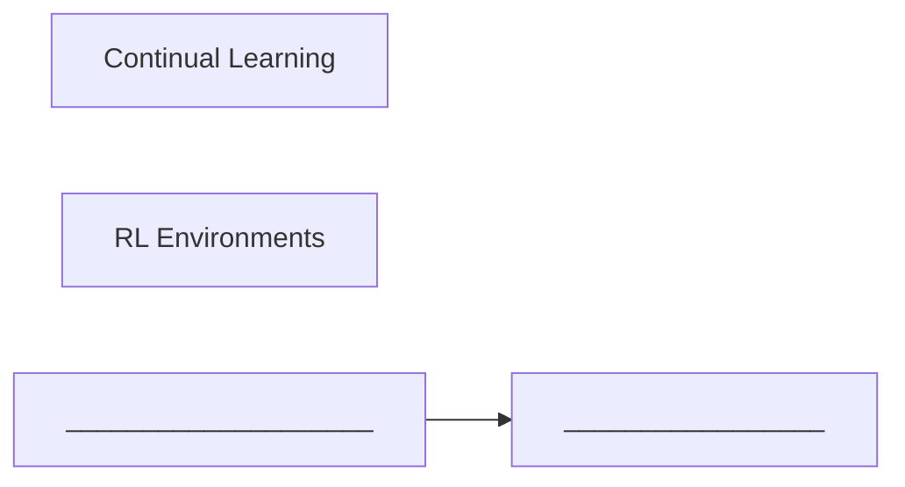

<h2 id="coding-delivery">Coding Agents & Software Delivery</h2>

Quality workflows, secure generated code, legacy modernization, and agent-scale source control.

### Key nodes

- **AI Coding Quality Workflows** ★ (`practice`) — Outcome-based quality, repo-aware agents, RAD-style iteration, and review under high code volume—great syntax is not enough.
- **Securing AI-Generated Code** ★ (`practice`) — Shift-left: trust outcomes not generation; security during coding; dependency scrutiny; intent clarity; continuous validation and guardrails.
- **Agent-Scale Source Control** (`problem`) — Concurrent agent writers break Git assumptions; backends need causal consistency and reusable packfiles.
- **Legacy Modernization with AI** (`practice`) — AI for discovery, translation, and agentic migration across architecture/tech/process axes—with human review limits.
- **Low-Resource Language Coding** (`practice`) — Behavior-preserving migration and evals for COBOL/Fortran-class languages where training data is thin.

### Articles in this cluster

- [AI Coding Workflows: Quality, RAD, IDEs, and Review](../ibm-ai-knowledge/ai-coding-quality-workflows.md) — AI made writing code the easy part. The industry’s anxiety shifted to everything after generation: Is this the *right* solution? Does it fit the codebase? Can humans still understand and own what ships?
- [Agent-Scale Source Control: When Concurrent Writers Break Git Assumptions](../extra-ai-knowledge/openai-news/agent-scale-source-control.md) — Coding agents multiply how much work one engineer can push at once: more branches, more CI clones, more fetches of the same commit. Source control that was “fine” for human cadence can collapse under agent…
- [Coding Agents for Low-Resource Languages: Build and Migrate Without Breaking Behavior](../extra-ai-knowledge/openai-news/low-resource-language-coding.md) — Models trained on oceans of Python and JavaScript historically struggled with **low-resource languages**—COBOL, Fortran, Visual Basic, and similar—despite those languages powering banking rails, weather codes, and…
- [Legacy Modernization with AI](../ibm-ai-knowledge/legacy-modernization-with-ai.md) — Imagine a “harmless” change that quietly stops millions of card and ATM transactions. For teams sitting on decades-old systems, that fear is why modernization is both urgent and hard—and why generative and agentic AI…
- [Parallel Agent Teams and Long-Running Coding Harnesses](../gap-fill-ai-knowledge/anthropic-news/parallel-agent-teams-and-coding-harnesses.md) — Single-session coding agents stall when the human leaves or the context window ends. Anthropic engineering on Claude Code, multi-agent compiler builds, and long-running harnesses teaches how to get sustained autonomou…
- [Securing AI-Generated Code: Five Shift-Left Principles](../ibm-ai-knowledge/securing-ai-generated-code.md) — AI changed how fast software can appear: prompts yield functions, tests, agents, and multi-step workflows in seconds. Security practices built for slower, human-paced coding do not automatically keep up. If security…

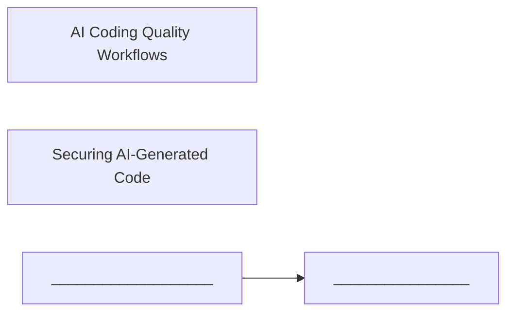

<h2 id="physical-ai">Physical AI, Voice & Autonomy</h2>

Robotics, fleet reliability, voice interfaces, and AI↔chip co-design.

### Key nodes

- **Physical AI / Robotics** ★ (`concept`) — Embodied agents combining VLA, on-device adaptation, and robot data factories that sensorize human experience to replace missing internet corpora.
- **Voice as Primary Interface** ★ (`technology`) — Speech as a default agent channel; production voice needs sub-100ms budgets, streaming STT/TTS, and measured autoscaling.
- **AI-Designed Chips** (`technology`) — Closing the loop: reward functions that match tapeout objectives and recursive AI↔silicon co-design.
- **Autonomy Reliability** (`practice`) — At fleet scale, reliability and ODDs are the product—Waymo/Zipline/Wayve-style safety learning.

### Articles in this cluster

- [AI That Designs Chips: Closing the Loop on Silicon](../sequoia-ai-knowledge/ai-designed-chips.md) — Ricursive Intelligence’s founders (Anna Goldie, Azalia Mirhoseini) represent a recursive bet: use AI to design the chips that run AI, informed by earlier Google work on learned placement and the painful gap between…
- [Autonomy at Scale: Reliability Is the Product](../sequoia-ai-knowledge/autonomy-at-scale.md) — Waymo’s Dmitri Dolgov (20M+ rides) and Zipline’s long-distance autonomous delivery record push the same lesson: in the physical world, **reliability engineering eats model demos**.
- [China’s Embodied AI: A Different Path Toward AGI](../gap-fill-ai-knowledge/cset-georgetown/chinas-embodied-ai-path.md) — Western AGI debates often equate progress with scaling LLMs. CSET’s December 2025 report *China’s Embodied AI: A Path to AGI* (Hannas, Chang, Weber, Chou) documents a broader Chinese research and industrial bet: intel…
- [Edge AI for Smart Cities: From Insight to Action](../gap-fill-ai-knowledge/ieee-spectrum-ai/edge-ai-smart-cities.md) — Smart-city AI that only ships dashboards leaves operators drowning in alerts. The Spectrum/Wiley edge-AI white paper (Intel-sponsored) pushes a next step: cognitive urban systems that turn real-time sensor insight int…
- [Edge AI: Few-Command Model Bring-Up for Physical Agents](../gap-fill-ai-knowledge/nvidia-technical-blog/edge-ai-tensorrt-edge-llm.md) — Cabin monitoring, robot perception, and line coordination need models next to sensors. These physical-AI applications must perceive, reason, and act within tight memory, power, and latency budgets. The historical tax…
- [Gemini Robotics: Whole-Body Physical AI](../extra-ai-knowledge/deepmind-blog/gemini-robotics-physical-ai.md) — Physical AI needs more than a chatbot that describes actions. Gemini Robotics 2 splits the stack into complementary models so robots can reason for minutes, control whole bodies, and run locally when the network is…
- [Robot Data Factories: Sensorizing Humans to Train Physical AI](../sequoia-ai-knowledge/robot-data-factories.md) — Language models pretrain on the internet. Robotics has no equivalent corpus. Sequoia’s robotics conversations converge on a manufacturing problem: **how to produce experience at scale**.
- [Robot Safety When Inputs Lie](../gap-fill-ai-knowledge/ieee-spectrum-ai/robot-safety-when-inputs-lie.md) — Classical robot safety asks whether the machine stays safe when something fails. Physical AI raises a sharper question: can it stay safe when an attacker changes what it sees, hears, or decides—while every safety func…
- [Sim-to-Real Robotics: SimReady Assets, Agent Planning, and Policy Training](../gap-fill-ai-knowledge/nvidia-technical-blog/robotics-simready-to-real.md) — Preparing CAD assets for robotics simulation requires more than converting geometry to OpenUSD: developers must configure and validate materials, collision geometry, joints, and other physics properties before testing…
- [Voice AI Latency Budgets: Sub-100ms Speech and Measured Autoscaling](../extra-ai-knowledge/aws-ml-blog/voice-ai-latency-budget.md) — Natural conversation has a temporal window. If synthesized speech arrives outside human turn-taking expectations, users hear awkward pauses, trust drops, and contact-center or sales agents lose the floor. Voice AI is…
- [Voice as a Primary Interface for AI](../sequoia-ai-knowledge/voice-as-interface.md) — ElevenLabs’ Mati Staniszewski argues voice is becoming a fundamental interface layer—not a niche accessibility feature. As models speak and listen fluidly, products can meet users in the channel where emotion, speed,…

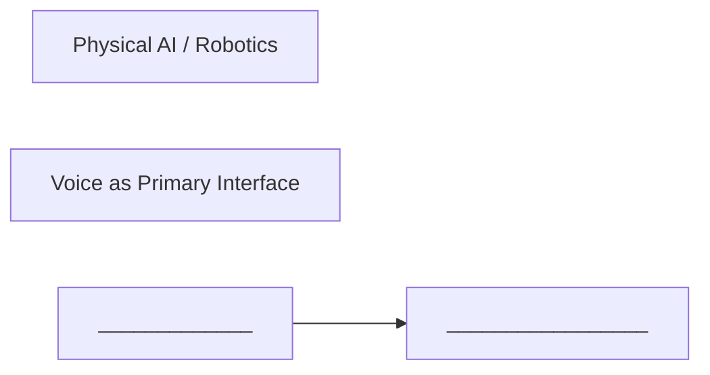

<h2 id="science-frontier">Science, Frontier & Interpretability</h2>

AGI last mile, science agents, applied labs, climate/earth AI, and biosecurity.

### Key nodes

- **Path to AGI (Last Mile)** ★ (`concept`) — Capability optimism tempered by remaining gaps in world models, experience learning, and scientific AI.
- **Science Agent Workflows** ★ (`practice`) — Skills/tool grounding and multi-agent hypothesis tournaments (Co-Scientist style) that scale interpretation then shepherd understanding.
- **Applied Research Labs** (`practice`) — Domain labs inside product companies: evals and vertical bitter-lesson strategies without full frontier budgets.
- **Biosecurity for Generative Biology** (`practice`) — Layered Swiss-cheese defenses, genomic atlases, and biological watermarks for generative bio tools.
- **Climate & Earth Observation AI** (`technology`) — Observation-driven weather and forest typology models that productize resolution for decision-makers.

### Articles in this cluster

- [AMIE: From Text Chat to Audio-Visual Clinical Consultation](../gap-fill-ai-knowledge/google-research-blog/amie-audiovisual-clinical-ai.md) — Articulate Medical Intelligence Explorer (AMIE) began as a research system for clinical reasoning and dialogue in text, later extended toward specialist-level evaluations in oncology, cardiology, and ophthalmology, an…
- [Applied Research Labs Inside Product Companies](../sequoia-ai-knowledge/applied-research-labs.md) — Harvey’s Gabe Pereyra describes building a serious research lab without frontier-lab budgets. The broader Sequoia pattern: **application companies are becoming research orgs** because domain intelligence is the moat.
- [Biology and Math Preprints: AI Acknowledgment Trends](../gap-fill-ai-knowledge/epoch-ai/science-ai-acknowledgment-trends.md) — Scientific fields are adopting AI at different tempos—and they disclose that adoption unevenly. Epoch’s preprint analyses turn acknowledgment language into a measurable diffusion signal: not a perfect census of use, b…
- [Biosecurity for Generative Biology: Watermarks and Layered Defense](../extra-ai-knowledge/deepmind-blog/biosecurity-synthid-bio.md) — AI that designs proteins and genomes accelerates medicine—and complicates biosecurity. Novel sequences may not match known-threat databases, so DNA synthesis screening cannot assume “unfamiliar ≈ natural.” DeepMind’s…
- [Chain-of-Evidence: Verifiable Autonomous Research](../gap-fill-ai-knowledge/google-research-blog/science-verification-chain-of-evidence.md) — “AI scientist” agents write papers, run code, and cite literature—then invent references, misreport scores, and describe methods their repos do not implement. Chain-of-Evidence (CoE) specifies trustworthiness properti…
- [Earth AI Geospatial Agents: Tools, Planning, and Planet-Scale Data](../gap-fill-ai-knowledge/google-research-blog/earth-ai-geospatial-agents.md) — Google Earth AI packages geospatial foundation models—remote sensing, weather, flood hydrology, population dynamics—and agents that compose them. The leap beyond “another satellite CNN” is a Geospatial Reasoning agent…
- [Grounding Biology Agents in Wet-Lab Reality (VERID)](../gap-fill-ai-knowledge/google-research-blog/wet-lab-biological-grounding.md) — Frontier models can propose candidates in combinatorial spaces (a 100-residue protein already exceeds astronomical sequence counts). Ideation is cheap; wet-lab execution fails on empty tips, wrong wells, volume errors…
- [Life Sciences Acceleration with Safeguards](../gap-fill-ai-knowledge/anthropic-news/life-sciences-acceleration-with-safeguards.md) — Frontier models can speed drug discovery, biomolecular design, and lab analysis—and the same breadth raises misuse risk. Anthropic’s life-sciences verification program, guest-investigator model, and drug-development p…
- [Mapping Methane from Space with Deep Learning](../gap-fill-ai-knowledge/google-research-blog/methane-mapping-from-space.md) — Methane warms roughly thirty times more than CO₂ over a century and decays faster, so cutting it is a near-term climate lever. More than a hundred countries in the Global Methane Pledge aim for large reductions this d…
- [Maternal Ultrasound Without a Sonographer: Blind Sweep + AI](../gap-fill-ai-knowledge/google-research-blog/maternal-ultrasound-blind-sweep.md) — WHO estimates more than 250,000 preventable pregnancy-related deaths yearly. Ultrasound improves outcomes, but expert sonography training is multi-year and scarce. Research systems interpret blind sweep ultrasounds: f…
- [Multi-Agent Science: Scale Interpretation, Then Shepherd Understanding](../extra-ai-knowledge/openai-news/multi-agent-scientific-discovery.md) — Modern experiments produce more data than any lab can thoroughly read. The complementary problem for AI-produced proofs and papers: raw model output is not yet scientific understanding. Two practices address the two…
- [Protein Design on GPUs: Reward-Guided Inference-Time Search](../gap-fill-ai-knowledge/nvidia-technical-blog/protein-design-reward-guided-search.md) — Protein design is a search problem. An eight-residue sequence already has more than 25 billion amino-acid combinations; at 100 residues the space exceeds the number of atoms in the observable universe. Exhaustive sear…
- [Science Agents: Skills, Tool Grounding, and Idea Tournaments](../extra-ai-knowledge/deepmind-blog/science-agent-workflows.md) — Scientific AI is moving from “answer a biology question” to **agents that run discovery workflows**—curating literature and structures, calling domain tools, proposing designs, and debating hypotheses. Two DeepMind…
- [Scientific Integrity vs AI-Written Papers](../gap-fill-ai-knowledge/ieee-spectrum-ai/scientific-integrity-vs-ai-slop.md) — Peer review was built for scarce human fraud and honest error—not industrial AI slop. Spectrum’s reporting—Benjamin Skuse’s “vibe-research” experiment, Harry Goldstein’s trust editorial, and Eliza Strickland’s intervi…
- [SymptomAI: Conversational Differential Diagnosis at Population Scale](../gap-fill-ai-knowledge/google-research-blog/symptomai-conversational-assessment.md) — A large share of clinical diagnoses still comes from language: structured interviews. SymptomAI studies whether conversational agents can run end-to-end symptom interviews and emit differential diagnoses (DDx) that cl…
- [TB Screening: When Foundation Models Meet Frontline Radiology](../gap-fill-ai-knowledge/google-research-blog/tb-screening-foundation-models.md) — Tuberculosis remains a top infectious killer—on the order of 1.23 million deaths yearly—despite being preventable and curable. Geography decides access: rural clinics and mining sites may be days from a radiologist. A…
- [Three Quarters to AGI—and What Still Blocks the Last Mile](../sequoia-ai-knowledge/path-to-agi.md) — Demis Hassabis’s Sequoia conversation is notable for calibrated optimism: substantial progress toward AGI, with remaining gaps that are conceptual, not only “more scale.”
- [Wearable Health Foundation Models: SensorFM and GlucoFM](../gap-fill-ai-knowledge/google-research-blog/wearable-health-foundation-models.md) — Billions of wearables stream heart rate, motion, SpO₂, temperature, and sleep for weeks. Labels are sparse; raw minutes are not. The foundation-model move for wearables is the same as for language: pretrain on unlabel…
- [WeatherNext and Earth Observation: AI for Climate Decisions](../extra-ai-knowledge/deepmind-blog/weathernext-climate-earth.md) — Weather and land-cover AI convert research models into **decision infrastructure**—hourly forecasts in consumer products, energy and agriculture variables, and forest maps that distinguish what “green” actually is.

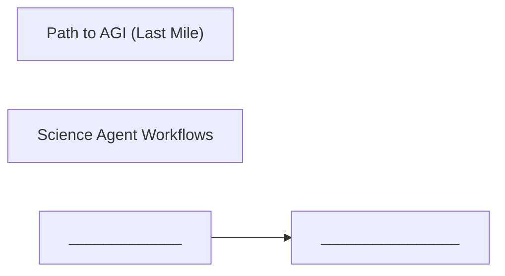

