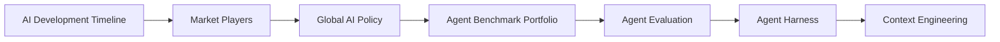

# AI Knowledge Graph

A digestible map of the Project’s teachable AI articles—**concepts first**, articles as hubs—not a flat dump of every page.

**Corpus start-here:** [`../README.md`](../README.md).

## What it covers

Merged ideas from:

| Corpus | Role |
|--------|------|
| [IBM Technology AI Knowledge](../ibm-ai-knowledge/index.md) | Engineering explainers (agents, inference, security, coding) |
| [Sequoia AI Knowledge](../sequoia-ai-knowledge/index.md) | Market, research, infra, physical AI framing |
| [Extra AI Knowledge](../extra-ai-knowledge/sources.md) | OpenAI News, Hugging Face, DeepMind, AWS ML Blog |
| [Gap-fill / landscape](../gap-fill-ai-knowledge/index.md) | Timeline, players, policy, agent benchmarks + Anthropic, Epoch, CSET, NVIDIA, Google Research, IEEE Spectrum, FPF |

**Graph size:** 263 nodes · 395 edges · 81 concepts/techs/problems/practices · 182 article hubs

## How to read it

1. **Start at concept hubs** marked *start here*—especially **Landscape & Orientation** (timeline → players → policy → benchmarks) before technique clusters.
2. **Follow typed edges:** `enables`, `constrains`, `solves`, `prerequisite`, `part_of`, `example_of`, `related_to`.
3. **Articles cite paths** so you can open the full explainer when a node matters.
4. **Clusters** group themes; synonyms are merged where noted.

### Suggested start-here path

## Top themes

- **[Landscape & Orientation](clusters.md#landscape-orientation)** — Timeline, market players, global policy, and agent benchmarks for onboarding.
- **[Agentic Systems & Engineering](clusters.md#agentic-systems)** — Harnesses, loops, long-horizon agents, and the market shift from copilots to autonomous workflows.
- **[Context, Tools & Knowledge Access](clusters.md#knowledge-access)** — Context engineering, RAG variants, MCP/skills/memory, semantic layers, and agent-ready APIs/web.
- **[Inference, Efficiency & Infrastructure](clusters.md#inference-infra)** — Serving physics, memory wall, quantization, routing, cost ops, and accelerators.
- **[Security, Safety & Control](clusters.md#security-safety)** — Trilemma, frontier safety, AI control, identity, intrusions, and provenance limits.
- **[Trust, Evaluation & Decision Quality](clusters.md#trust-evals)** — When to trust AI, calibrated decisions, agent evals, benchmark hygiene, specs, and interpretability.
- **[Enterprise Adoption & Governance](clusters.md#enterprise-gov)** — Diffusion, platforms, owning weights, sovereignty, sensitive data, and deployment gap closure.
- **[Training, Learning & Data](clusters.md#training-data)** — Continual learning, RL environments, data efficiency, collapse, LoRA/distillation, world models.
- **[Coding Agents & Software Delivery](clusters.md#coding-delivery)** — Quality workflows, secure generated code, legacy modernization, and agent-scale source control.
- **[Physical AI, Voice & Autonomy](clusters.md#physical-ai)** — Robotics, fleet reliability, voice interfaces, and AI↔chip co-design.
- **[Science, Frontier & Interpretability](clusters.md#science-frontier)** — AGI last mile, science agents, applied labs, climate/earth AI, and biosecurity.

## Browse

- **[Interactive explorer](explore.html)** — filter by cluster, search nodes, inspect neighbors (loads `graph.json`)
- **[Thematic clusters](clusters.md)** — clusters with key nodes and articles
- **[graph.json](graph.json)** — machine-readable nodes + edges
- **Readable HTML:** [`../ai-knowledge-articles-readable/articles.html`](../ai-knowledge-articles-readable/articles.html)
- **Theme essays:** [`../ai-knowledge-by-theme/themes.html`](../ai-knowledge-by-theme/themes.html)

## Node & edge legend

| Node type | Meaning |
|-----------|---------|
| `concept` | Core idea |
| `technology` | Concrete system/technique |
| `problem` | Constraint or failure mode |
| `practice` | How-to / operating pattern |
| `article` | Teachable article hub (path + blurb) |

| Edge type | Meaning |
|-----------|---------|
| `enables` | Source makes target practical |
| `constrains` | Source limits or pressures target |
| `solves` | Source addresses target problem |
| `prerequisite` | Learn/build source before target |
| `part_of` | Source is a component of target |
| `example_of` | Article/instance of a concept |
| `related_to` | Cross-link without stronger claim |

## Start-here concepts

- **AI Development Timeline** (Landscape & Orientation) — Readable chronology of modern AI eras—from feature engineering through foundation models and assistants to agents—anchored by compute, capability frontiers, and adoption.
- **Global AI Policy Regimes** (Landscape & Orientation) — Comparing US frameworks, EU risk-tier law, UK pro-innovation coordination, China’s layered control, and privacy/ADM/chatbot statutes as navigable institutions.
- **Market Players & Stack Roles** (Landscape & Orientation) — Who does what in the AI stack—frontier labs, hyperscalers, open-weight ecosystems, chip/infra, states, enterprises, and startups—as roles rather than brand lists.
- **AI Coding Quality Workflows** (Coding Agents & Software Delivery) — Outcome-based quality, repo-aware agents, RAD-style iteration, and review under high code volume—great syntax is not enough.
- **AI Security Trilemma** (Security, Safety & Control) — Tension among smart, fast, and secure—agents raise stakes via excessive agency; OWASP LLM risks and resilience when models are fooled.
- **Agent Benchmark Portfolio** (Trust, Evaluation & Decision Quality) — Designing and reading agent eval suites—SWE-bench, MirrorCode, computer-use/browsing, capability indices—while accounting for contamination, scaffolding, and Goodhart effects.
- **Agent Era Market Frame** (Agentic Systems & Engineering) — Commercial definition of the agent era: computation revolutions, long-horizon agents, and customer-back moats—cars, not faster horses.
- **Agent Evaluation** (Trust, Evaluation & Decision Quality) — Measure outcomes on real tasks (LifeVal, executable grading, factuality slices)—not only exam scores or tool-call theater.
- **Agent Harness** (Agentic Systems & Engineering) — The operating system around the model loop—tools, middleware, recovery, and policies—where most product differentiation lives once the LLM-in-a-loop is commodity.
- **Agent Identity & On-Behalf-Of** (Security, Safety & Control) — Cryptographic per-agent identity and OBO token exchange so actions are attributable; shared service accounts fail audit.
- **Agentic Engineering** (Agentic Systems & Engineering) — A discipline beyond vibe coding: designing prompts, context, harnesses, loops, and multi-agent graphs so agents produce reliable software and workflows at scale.
- **Context Engineering** (Context, Tools & Knowledge Access) — Selecting what information enters the model window, when, and in what form—because huge context windows still fail via poisoning, distraction, confusion, and clash.
- **Continual Learning** (Training, Learning & Data) — Frozen deployed models stall; restarting learning from experience is the path past the age of static pretraining.
- **Enterprise AI Diffusion** (Enterprise Adoption & Governance) — Enterprises often reject the AI they requested; reinvention via workflow KPIs and agents beats bolted-on feature packs.
- **Enterprise Agent Platforms** (Enterprise Adoption & Governance) — Federate ownership in workstream cells while centralizing paved-road gateways, eval-gated promotion, and control planes.
- **Frontier Safety Stack** (Security, Safety & Control) — Capability-triggered safeguards spanning misuse, misalignment, and injection—with input, activation, and monitor layers.
- **LLM Inference** (Inference, Efficiency & Infrastructure) — Serving live answers from weights: tokenization, continuous batching, and the prefill (compute-bound) vs decode (memory-bound) split behind latency metrics.
- **Long-Horizon Agents** (Agentic Systems & Engineering) — Agents that persist across multi-day or multi-step work with harness support and honest scope fidelity, not just clever single-shot answers.
- **MCP (Model Context Protocol)** (Context, Tools & Knowledge Access) — A protocol pattern for exposing tools and resources to agents with progressive discovery, reducing ad-hoc API wiring.
- **Memory Wall** (Inference, Efficiency & Infrastructure) — Decode-phase bandwidth starvation that limits LLM scaling; drives parallelism strategies and prefill–decode disaggregation.
- **Model Routing** (Inference, Efficiency & Infrastructure) — Choosing model tier, reasoning depth, caching, and harness design along the cost–intelligence frontier for affordable production agents.
- **Own Your Weights** (Enterprise Adoption & Governance) — Private post-training encodes company taste and control when renting frontier APIs collides with cost, speed, and sovereignty.
- **Path to AGI (Last Mile)** (Science, Frontier & Interpretability) — Capability optimism tempered by remaining gaps in world models, experience learning, and scientific AI.
- **Physical AI / Robotics** (Physical AI, Voice & Autonomy) — Embodied agents combining VLA, on-device adaptation, and robot data factories that sensorize human experience to replace missing internet corpora.
- **Quantization** (Inference, Efficiency & Infrastructure) — Reducing numeric precision (FP16→int8/int4) via PTQ or QAT to cut memory and serving cost, with healing/distillation to protect accuracy.
- **RAG (Retrieval-Augmented Generation)** (Context, Tools & Knowledge Access) — Grounding model answers in retrieved documents or data; evolving from flat chunks toward structure-aware and agentic retrieval across corpora.
- **RL Environments** (Training, Learning & Data) — Worlds, apps, and verifiers that let agents learn real jobs—the missing dataset after web text; best shared openly on hubs.
- **Science Agent Workflows** (Science, Frontier & Interpretability) — Skills/tool grounding and multi-agent hypothesis tournaments (Co-Scientist style) that scale interpretation then shepherd understanding.
- **Securing AI-Generated Code** (Coding Agents & Software Delivery) — Shift-left: trust outcomes not generation; security during coding; dependency scrutiny; intent clarity; continuous validation and guardrails.
- **Trusting AI Decisions** (Trust, Evaluation & Decision Quality) — Probability is not proof; hybrid rules-then-agents, risk-driven architecture, and governance (e.g. ISO 42001-style) decide when AI may act.
- **Voice as Primary Interface** (Physical AI, Voice & Autonomy) — Speech as a default agent channel; production voice needs sub-100ms budgets, streaming STT/TTS, and measured autoscaling.
